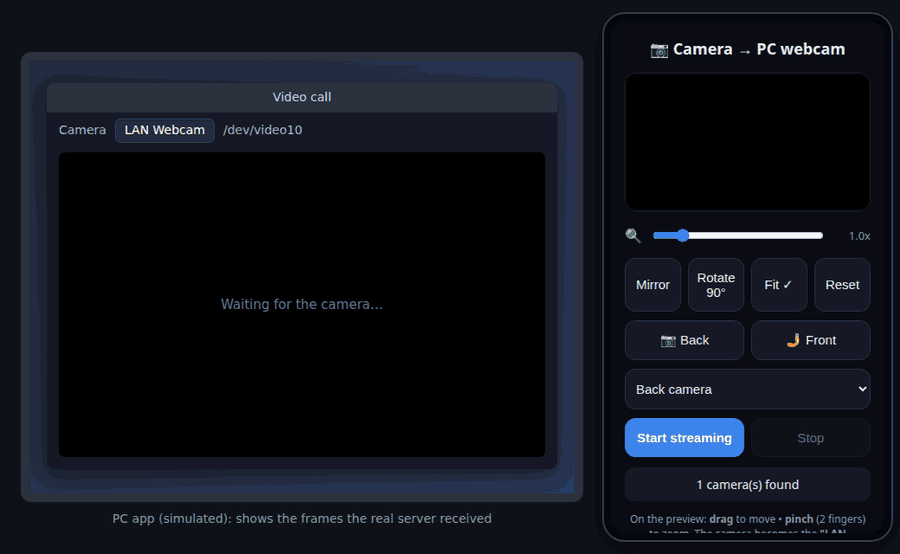

<div align="center">

# LAN Webcam

**Any camera on your local network becomes a webcam on the PC (`/dev/video10`, "LAN Webcam").**


[](https://github.com/gabrielogregorio/devkit-lan-webcam/actions/workflows/tests.yml)
[](https://github.com/gabrielogregorio/devkit-lan-webcam/actions/workflows/check-quality.yml)
[](https://github.com/gabrielogregorio/devkit-lan-webcam/actions/workflows/codeql-analysis.yml)
[](https://github.com/gabrielogregorio/devkit-lan-webcam/releases)

<br>



<sub>Recorded with the real page, TLS and WebSocket server, a simulated camera and a simulated PC app: frames went to the demo, not to <code>/dev/video10</code>.</sub>

</div>

## About

Turns the camera of any device on the same network (phone, tablet, another laptop) into a
**virtual webcam on the PC** (Ubuntu). The device opens a web page served by the PC, captures its
camera and sends the frames; on the PC they become the `/dev/video10` device that apps (Chrome,
Zoom, OBS, Meet…) list as the **"LAN Webcam"** camera. No app to install on the device: a browser
with camera access is enough.

> **Same network required.** The camera device and the PC must be on the same local network (same
> Wi-Fi or the same router, cable counts). The page is reached by the PC's local IP
> (`https://<pc-ip>:9443`); nothing goes through the internet, so it does not work from another
> network or over mobile data. A guest Wi-Fi with client isolation also blocks it.

- **Live controls on the page:** zoom (slider or pinch), drag to move, mirror, rotate 90°, fit or
  crop, reset, back/front camera buttons and a lens dropdown.
- **The preview is the canvas that is sent:** what you see on the device is exactly what the PC gets.
- **Language:** the page follows the browser language. A `pt*` language shows Brazilian Portuguese,
  anything else shows English. Force one with `?lang=en` or `?lang=pt-BR` in the address.

Built and tested on Ubuntu 24.04.

## Set up on a new PC

1. **Install** (asks for sudo: `v4l2loopback-dkms`, `ffmpeg`, `python3-venv`…, the venv and the HTTPS
   certificate):
   ```bash
   git clone <repo-url> devkit-lan-webcam
   cd devkit-lan-webcam
   ./setup.sh
   ```
2. **Make the virtual webcam permanent** (loads at boot with `exclusive_caps=1`, which Chrome needs):
   ```bash
   sudo bash reload-cam.sh
   ```
   With Secure Boot on, `v4l2loopback-dkms` asks to enroll a key (MOK) during the install; accept it
   and confirm on the next boot, or the module does not load.
3. **Optional, recommended:** let `run.sh` reload the module without a password on every start
   (avoids the `VIDIOC_G_FMT` error on the 2nd opening). The 3 commands are at the top of
   `reload-mod.sh`, and `run.sh` prints them when it does not find the setup.
4. **Check and use:**
   ```bash
   ./run.sh status     # server + /dev/video10 + exclusive_caps
   ./run.sh            # starts and prints the address for the device
   ```
   Use Google Chrome from the `.deb` on the PC (the snap does not see `/dev/video10`).
5. **Top bar icon (optional):** `./tray_icon.py --install` puts an icon on the top bar at every
   login, gray while off. Its menu turns the server on and off; turning it on opens a QR code with
   the address, so the device does not need it typed:

   

   The menu follows the system language (the screenshot is in Brazilian Portuguese: Ligado = On,
   Mostrar QR code = Show QR code). The address is the PC's local IP, so the QR code only works on
   the same network. Without `python3-segno` the QR window shows only the address.
   `./tray_icon.py --remove` takes the icon out of the login.
   The icon runs on the system python3 and needs `sudo apt install python3-gi gir1.2-gtk-3.0
   gir1.2-ayatanaappindicator3-0.1` (already on a standard Ubuntu desktop) plus `python3-segno` for
   the QR code.

   Menu: the status line ("LAN Webcam (camera over the network): on air (port 9443)"), **On**
   (starts or stops the server), the address for the device, **Show QR code**, **Open in the
   browser**, **View log** (the server output). A middle click on the icon toggles it.

**Outside the repository:**

| Path | What |
|---|---|
| `cert.pem`, `key.pem` | self-signed HTTPS certificate, generated, ignored by git |
| `.venv/` | Python venv with `aiohttp` (Ubuntu's Python is externally managed: never a global pip) |
| `/etc/modprobe.d/v4l2loopback.conf` | module options (`video_nr=10`, `card_label="LAN Webcam"`, `exclusive_caps=1`) |
| `/etc/modules-load.d/v4l2loopback.conf` | loads the module at boot |
| `/usr/local/sbin/webcam-cam-reload`, `/etc/sudoers.d/webcam` | optional passwordless module reload (step 3) |
| `~/.config/autostart/devkit-lan-webcam-tray.desktop` | starts the top bar icon at login, off (`./tray_icon.py --install`; `--remove` takes it out) |
| `~/.local/share/applications/devkit-lan-webcam-tray.desktop` | app menu shortcut for the icon (same command) |
| `~/.cache/devkit-lan-webcam/` | the icon's `server.log` ("View log"), on/off SVGs, the QR code PNG and its lock |

Moved the folder? Recreate the venv (`mv .venv trash/` and `./run.sh` creates it again).

## Available scripts

```bash
# Run
./run.sh            # starts and prints the address (Ctrl+C stops it)
./run.sh status     # server + virtual webcam
./run.sh stop
./run.sh restart

# Top bar icon (on/off, QR code), at every login
./tray_icon.py --install
./tray_icon.py --remove

# Test (never touches port 9443 nor the real /dev/video10)
./run-tests.sh                      # lint + backend + frontend + launcher (~2 s)
RUN_E2E=1 ./run-tests.sh            # + Playwright E2E (npm install --no-save playwright@1.62.0 && npx playwright install chromium-headless-shell)
RUN_DEVICE_TESTS=1 ./run-tests.sh   # + the real /dev/video10

# Dependencies (uv)
uv sync --all-groups
uv lock && uv export --frozen --no-dev --no-emit-project --no-hashes -o requirements.txt
```

## Tests

| Kind | Where | What it covers |
|---|---|---|
| **Lint** | `pyproject.toml` (ruff), ShellCheck | Python style, import order, bug patterns; warnings in every `.sh` |
| **Backend** | `tests/backend/` (pytest) | routes and no-cache headers, only the page scripts are served (never `key.pem`), one ffmpeg per connection, frames reach its stdin, clean stop on disconnect, broken pipe, ffmpeg missing, env vars |
| **Frontend** | `tests/frontend/` (`node:test`) | view state math (zoom, pan, rotation, fit, mirror) and the i18n catalog: every page string has its pt-BR line with the same `{placeholders}`, language detection |
| **Launcher** | `tests/launcher/test_launcher.sh` | `run.sh` in a sandbox with stubs: status, missing device, `exclusive_caps` warning, single instance, stop, usage |
| **E2E** | `tests/e2e/` (Playwright) | the real `server.py` over TLS with ffmpeg swapped for `cat`, Chromium with a fake camera: preview, back/front switching, fast clicks, frames reaching the server |
| **Device** | `tests/backend/test_device_integration.py` | opt-in: `/dev/video10` exists and is readable and writable |

`./run-tests.sh` prints a scoreboard and skips what is not installed (ShellCheck:
`sudo apt install shellcheck`), saying so. The E2E runs in English.

## CI/CD

GitHub Actions, in `.github/`:

| Workflow | When | What |
|---|---|---|
| `tests.yml` | push/PR to `main`, manual | unit layers (lint, backend, frontend, launcher), then the E2E with Playwright; the server log is uploaded when the E2E fails |
| `check-quality.yml` | push/PR to `main` | ruff, ShellCheck, JavaScript syntax, `.sh` files executable in git, actions pinned to a hash, workflow YAML |
| `codeql-analysis.yml` | push/PR, weekly | CodeQL for Python, JavaScript and the workflows |
| `auto-complete-fields.yml` | PR opened/updated | assigns the author, labels by commit words and touched files, lists the commits in the PR body (`[...autoGenerate]`), titles it `Release vX.Y.Z - …`, fails on a `release/x.x.x` branch if that version was already released |
| `create-tag-and-release.yml` | PR merged into `main` | creates the tag `vX.Y.Z` from `VERSION` and a GitHub release with the PR text, generated notes, the source tarball and `SHA256SUMS` (a `-rc.1` style version becomes a pre-release) |

`setup-environment` (composite action) sets up Node, creates the venv from `requirements-dev.txt`
and, for the E2E, installs Playwright and a throwaway certificate.

**Pinned versions.** Every third-party action is pinned to the full commit hash of its release tag,
with the version as a comment, so a moved or hijacked tag cannot change what runs:

| Action | Version | Commit |
|---|---|---|
| `actions/checkout` | v6.1.0 | `d23441a48e516b6c34aea4fa41551a30e30af803` |
| `actions/setup-node` | v7.1.0 | `949feb2413d6458794dcd2491c4babbbce0c15c1` |
| `actions/upload-artifact` | v6.0.0 | `b7c566a772e6b6bfb58ed0dc250532a479d7789f` |
| `actions/github-script` | v8.0.0 | `ed597411d8f924073f98dfc5c65a23a2325f34cd` |
| `github/codeql-action` (init, analyze) | v4.39.1 | `9b3254085494b55a0f7c4c2b3d2d52cc712ce370` |

The rest is pinned too: runners on `ubuntu-24.04` (not `ubuntu-latest`), Node 22, Python packages
from `uv.lock` (through `requirements-dev.txt`, ruff included) and `playwright@1.62.0`.
`check-quality.yml` fails if a `uses:` is not a 40-character hash (local `./` actions excepted).
Dependabot opens a monthly PR that bumps the hash and the comment together. To pin one by hand:

```bash
git ls-remote --tags https://github.com/actions/setup-node.git 'v7.1.0^{}' 'v7.1.0'   # the ^{} line, when present, is the commit
```

### Releasing

1. In a PR from a `release/x.x.x` branch, bump `VERSION` (semver: `1.1.0`, or `1.1.0-rc.1` for a pre-release).
2. Merge into `main`. The tag and the release are created on their own.

What the release is built from:

| Part | Source |
|---|---|
| Tag | `v` + `VERSION` at the merge commit, pointing at that commit |
| Title | `LAN Webcam vX.Y.Z` |
| Notes | the PR title (without the `Release vX.Y.Z - ` prefix), then the PR body with the commit list that `auto-complete-fields.yml` filled in (the `[...autoGenerate]` marker is removed), then GitHub's generated notes (merged PRs, contributors, "Full Changelog" link to the previous tag) |
| Files | `devkit-lan-webcam-X.Y.Z.tar.gz` (`git archive` of the merge commit: only tracked files) and `SHA256SUMS` |
| Type | a version with `-` (e.g. `1.1.0-rc.1`) is a pre-release; any other becomes "latest" |

If the tag already exists (the PR did not bump `VERSION`), nothing is released and the run leaves a
warning. On a `release/x.x.x` branch, the PR check `VERSION is new` catches that before the merge;
PRs from any other branch skip it, so they can merge without a new version.

Issues use forms (`bug_report.yml`, `feature_request.yml`); PRs start from `pull_request_template.md`.

## Usage (order matters)

1. Start the server on the PC (`./run.sh`).
2. **On the camera device** (on the **same network** as the PC): open `https://<pc-ip>:9443` (or scan
   the QR code from the top bar icon) and accept the certificate warning. Pick the camera (**📷 Back** / **🤳 Front** or the dropdown): the preview shows up even
   before streaming. Adjust zoom and position, then **Start streaming** (status 🟢). Hold a phone
   **sideways (landscape)** to match the 16:9 webcam. Keep the tab open and the screen on.
3. **On the PC:** apps only look for cameras when they open, so close and reopen the target app
   **with the feed already on**, and pick **"LAN Webcam"**.

## Architecture

```
[Camera device] getUserMedia → canvas → JPEG (~25 fps)
   │  WebSocket (wss, binary)
   ▼
[PC] server.py (aiohttp, HTTPS port 9443)
   │  writes the JPEGs to ffmpeg's stdin
   ▼
[ffmpeg]  -f mjpeg -i pipe:0 → scale/yuv420p → -f v4l2 /dev/video10
   ▼
[v4l2loopback]  /dev/video10  ("LAN Webcam")  → Chrome/Zoom/OBS/…
```

- **HTTPS is required:** browsers only allow `getUserMedia` outside `localhost` in a secure context.
  Self-signed certificate in `cert.pem`/`key.pem` (accept the warning on the device).
- `ffmpeg` starts **per WebSocket connection** (in `ws_handler`) and is killed on disconnect.
- Each frame is a whole JPEG; `ffmpeg -f mjpeg` reads the stream from `pipe:0`.
- The page and its scripts are served with `Cache-Control: no-store`, so the device always gets the
  latest version (without it, page edits did not arrive because of the browser cache). Only
  `index.html`, `view.js` and `i18n.js` are served; nothing else in the folder is reachable.
- The preview on the device **is the canvas itself**; the camera opens in a hidden `<video>` that is
  the drawing source.
- A stalled network does not pile up frames: a frame is skipped while the socket has more than
  1 MB buffered.

## Project layout

| File | Role |
|---|---|
| `run.sh` | **launcher**: `start`/`stop`/`status`/`restart`; creates the venv/certificate when missing, checks the device and `exclusive_caps`, keeps a single instance |
| `server.py` | aiohttp HTTPS + WebSocket server; spawns the ffmpeg that feeds `/dev/video10` |
| `tray_icon.py` | top bar icon: turns the server on and off, QR code; `--install` starts it at every login |
| `index.html` | the device page: live preview, controls, camera choice; sends JPEGs over the WebSocket |
| `view.js` | pure view state logic (zoom/pan/rotation/fit), imported by the page and tested in Node |
| `i18n.js` | language detection and the pt-BR catalog (English is the source text) |
| `setup.sh` | first install (apt + venv + certificate + module) |
| `reload-cam.sh` | (sudo) reloads `v4l2loopback` with `exclusive_caps=1` and writes the permanent config |
| `reload-mod.sh` | clean module reload, installed as a root-only wrapper for `run.sh` |
| `run-tests.sh` | single test runner with a scoreboard, the same steps as the CI |
| `tests/` | `backend/` (pytest), `frontend/` (`node:test`), `launcher/` (bash), `e2e/` (Playwright) |
| `pyproject.toml`, `uv.lock` | dependencies (`aiohttp` + `dev` group) and their lock, the source of truth |
| `requirements*.txt` | exports of the lock, never edited by hand |
| `VERSION` | current version; the release workflow tags from it |
| `.github/` | workflows, setup action, issue forms, PR template, Dependabot |
| `docs/` | README images (camera page, tray QR code), saved without metadata |

Adding page text: write it in English, either as `t('…')` in the script or as the content of an
element with `data-i18n` (`data-i18n-html` when it has markup), and add the pt-BR line to `PT_BR` in
`i18n.js`. The frontend tests fail if it is missing, if the `{placeholders}` differ or if a pt-BR
line is no longer used. Terminal output is English only.

## Dependencies

`pyproject.toml` declares, `uv.lock` locks, the `requirements*.txt` files are **exports of the lock**.
`run.sh` and `setup.sh` create the venv from `requirements.txt`; for the tests add the dev group:

```bash
uv sync --all-groups                           # with uv: aligns .venv with the lock
.venv/bin/pip install -r requirements-dev.txt  # without uv (never a global pip, PEP 668)
```

After changing `pyproject.toml`, lock and export again:

```bash
uv lock
uv export --frozen --no-dev      --no-emit-project --no-hashes -o requirements.txt
uv export --frozen --all-groups  --no-emit-project --no-hashes -o requirements-dev.txt
```

## Settings

- **Port:** **9443** by default. Override: `PORT=xxxx ./run.sh`.
- **Resolution / FPS / device:** env vars read by `server.py`: `CAM_DEVICE`, `CAM_WIDTH`,
  `CAM_HEIGHT`, `CAM_FPS`, `PORT`. E.g. `CAM_WIDTH=720 CAM_HEIGHT=1280 ./run.sh` for a **portrait**
  webcam (matches a phone held upright); then change `CANVAS_WIDTH`/`CANVAS_HEIGHT` in `index.html` too.
- **JPEG quality / FPS / capture size:** constants at the top of the `<script>` in `index.html`
  (`CANVAS_WIDTH`, `CANVAS_HEIGHT`, `FPS`, `JPEG_QUALITY`).
- **Framing / transforms:** the `view` state and the pure functions in `view.js`
  (`computeDrawParams`, `setZoom`, `panBy`, `cycleRotation`, `toggleFit`, `toggleMirror`), applied by
  `drawFrame()` in `index.html`.
- **Webcam name:** `card_label` in `reload-cam.sh`, `reload-mod.sh` and `setup.sh`. After changing
  it, run `sudo bash reload-cam.sh` (and reinstall the wrapper from step 3, if you use it).

## Limitations

- **Same local network only.** The device reaches the PC by its LAN IP; another network, mobile data
  or a Wi-Fi with client isolation does not work.
- **Trusted network only.** `/ws` has no authentication: anyone on the same LAN who opens
  `wss://<ip>:9443/ws` feeds your virtual webcam. Do not expose the port to the internet.
- **One camera at a time.** Each WebSocket connection starts its own ffmpeg on the same
  `/dev/video10`; two at once fight over the device.
- **Video only,** no audio (`audio: false` in `getUserMedia`).
- **Snap apps do not see the virtual camera** (Firefox snap, Ubuntu's "Camera" app: "could not play
  camera stream"), a limit of the confinement. Use Google Chrome from the `.deb`.
- The virtual webcam is permanent (loads at boot). If it disappears: `sudo bash reload-cam.sh`.
  Test it directly with `ffplay /dev/video10`.

## License

[MIT](LICENSE). Use, copy, modify and distribute freely; the software is provided "as is", without
warranty of any kind.
